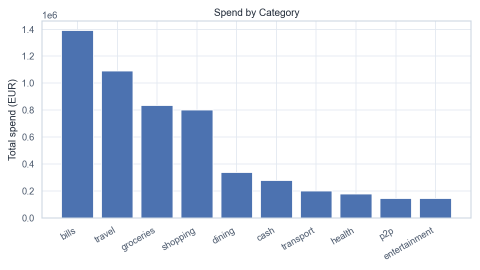
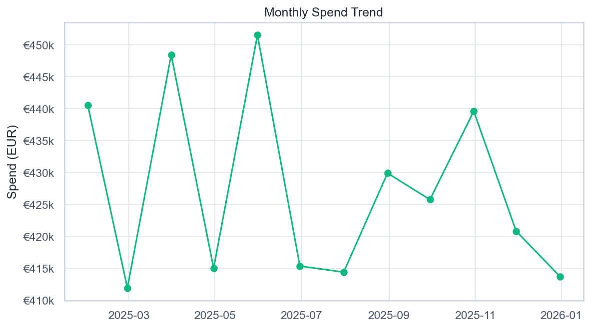

# Volta — Spend Analysis

[](https://github.com/NikitaBoyarkin/case-spend/actions/workflows/ci.yml)

[](LICENSE)

Spend breakdown by category and channel: bills (25.8%) and travel (20.2%) make up nearly half the turnover, groceries is the most frequent category.

## Navigation

- 📖 [Full case study on the portfolio site](https://nikitaboyarkin.github.io/en/projects/volta/spend/)
- 🏦 [Parent project: volta-banking](https://github.com/NikitaBoyarkin/volta-banking)
- 🧪 Related cases: [segmentation](https://github.com/NikitaBoyarkin/case-segmentation) · [anomalies](https://github.com/NikitaBoyarkin/case-anomalies)

**On this page:** [Key results](#key-results) · [Situation](#situation) · [Task](#task) · [Actions](#actions) · [Result](#result) · [Recommendations](#recommendations) · [Charts](#charts) · [Dataset](#dataset) · [Quick start](#quick-start)

## Key results

- Bills 25.8% and travel 20.2% — nearly half the turnover
- Groceries — 18,238 transactions
- Decline rate and monthly trend

## Situation

Where and on what customers spend — the basis for cashback and offer strategy.

## Task

I needed to establish where and on what customers spend, so I owned the spending layer that the cashback and offer strategy is built on.

## Actions

- Spend aggregation by category/channel/merchant.
- Decline rate by category, monthly trend.

## Result

- **Bills (25.8%)** and **travel (20.2%)** are the largest categories; together nearly half the turnover.
- **Groceries** is the most frequent (18,238 transactions, €45.8 average ticket).
- Travel is thin-margin (see Project 14).

## Recommendations

- Build cashback/offers around top categories (bills, groceries).
- Watch travel margin as volume grows.
- Monitor the decline rate as a payment-UX signal.

## Charts





> # Monthly Spend Trend
>
> 
>
> *Помесячный объём трат по завершённым транзакциям.*
>
> ## Выводы
>
> - Пик трат — 2025-05 (€451 552).
> - С 2025-01 по 2025-12 месячный объём изменился на -6,1%.
> - Средний месячный объём — €427 267.
> - Колебания держатся в коридоре €411 934–€451 552 (±6% от среднего): выраженной сезонности нет, ноябрь–декабрь — локальное снижение.
>
> ---
> <sub>Источник: `scripts/volta_spend_analysis.py` · данные: `data/volta_transactions.csv`</sub>

## Dataset

The dataset is fully synthetic, generated by seeded, reproducible script(s) (`scripts/generate_transactions_data.py`). No real customer data is used. Running `make data` regenerates the CSV(s) in `data/` with the same random seed, so every number below is reproducible.

## Quick start

```bash
uv sync --all-groups
make data
make run
```

## Project structure

```text
case-spend/
├── README.md
├── LICENSE
├── .gitignore
├── .python-version
├── pyproject.toml
├── Makefile
├── .github/workflows/ci.yml
├── scripts/
│   ├── generate_transactions_data.py
│   └── volta_spend_analysis.py
├── utils/
│   ├── __init__.py
│   ├── common.py
│   └── viz_helpers.py
├── data/
│   └── volta_transactions.csv
├── outputs/
│   ├── spend_by_category.png
│   ├── spend_monthly_trend.png
└── tests/
    └── test_spend.py
```

## Stack

- Python
- pandas / NumPy
- SciPy / Statsmodels
- scikit-learn
- Matplotlib / Seaborn
- uv + ruff

## Links

- [Full case study on the portfolio site](https://nikitaboyarkin.github.io/en/projects/volta/spend/)
- [Parent project — volta-banking](https://github.com/NikitaBoyarkin/volta-banking)
